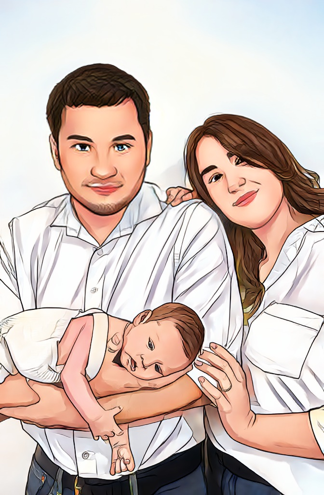
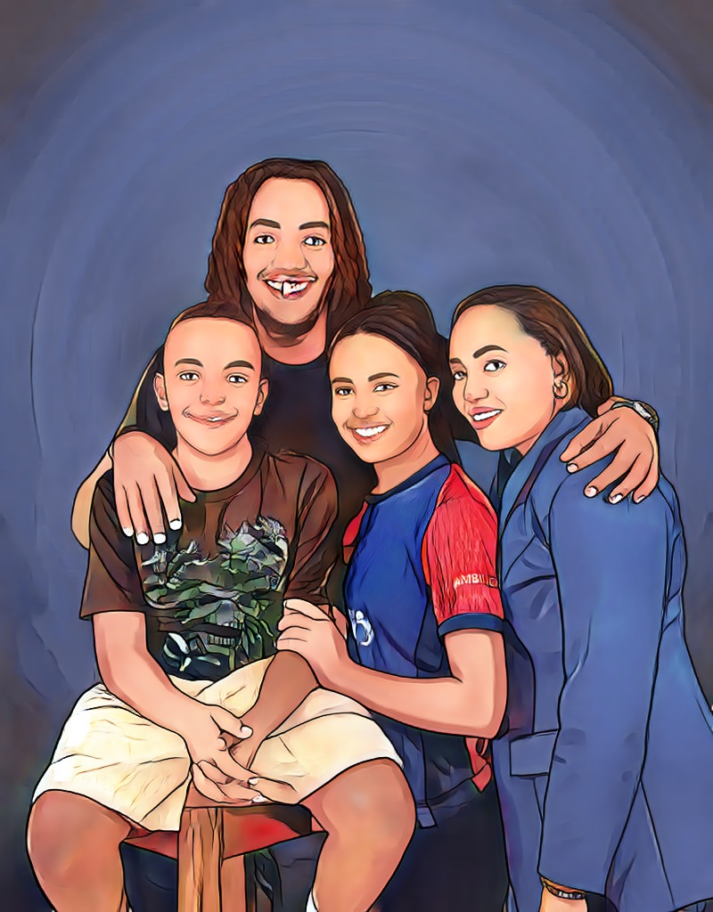

<p align="center">
  <h1 align="center">Photo to Cartoon Illustration</h1>
  <p align="center">
    <strong>Convert any photo into a cartoon illustration with a single Python call.</strong><br>
    An AI-powered image-to-illustration model that turns real photos into cartoon-style artwork. No diffusion steps, no cloud API, no GPU required — one forward pass through a lightweight neural network and your photo becomes an illustration. A dedicated face refinement pipeline redraws every face with crisp cartoon detail.
  </p>
</p>

<p align="center">
  <a href="https://www.thearifoffice.com">Website</a> &nbsp;&bull;&nbsp;
  <a href="#getting-started">Getting Started</a> &nbsp;&bull;&nbsp;
  <a href="#python-api">Python API</a> &nbsp;&bull;&nbsp;
  <a href="#command-line">CLI</a>
</p>

<p align="center">
  <code>photo to cartoon</code> &nbsp;·&nbsp;
  <code>image to illustration</code> &nbsp;·&nbsp;
  <code>AI cartoon filter</code> &nbsp;·&nbsp;
  <code>cartoonize photo python</code> &nbsp;·&nbsp;
  <code>neural style transfer</code> &nbsp;·&nbsp;
  <code>face cartoonizer</code>
</p>

---

## Cartoon Illustration Results

> Every image below was generated from a real photo in a single forward pass — no cherry-picking, no manual touch-up.

<p align="center">
  
  &nbsp;&nbsp;
  
</p>

<p align="center">
  
  &nbsp;&nbsp;
  
</p>

<p align="center">
  
  &nbsp;&nbsp;&nbsp;&nbsp;
  
</p>

## Why This Cartoon Filter

- **Single-pass cartoon conversion** — no iterative diffusion, no denoising loops. One forward pass converts your photo to a cartoon illustration instantly.
- **AI face refinement** — a second neural network detects and redraws every face in the photo with clean cartoon lines, then blends them seamlessly back into the scene.
- **Runs on CPU** — no GPU needed. Converts a photo to cartoon in ~5 seconds on a desktop CPU, under 1 second on GPU.
- **Two-file codebase** — just `cartoonify.py` and `model.py`. No heavy frameworks, no cloud dependency, fully offline.
- **Batch cartoonize** — point it at a folder and convert every photo to a cartoon illustration in one command.
- **Python API + CLI** — import it in your app or run it from the terminal.

## How the Cartoon Model Works

The photo-to-cartoon model uses a **U-Net generator** trained with a pix2pix-HD approach. The main model processes the full image at 1024px resolution. A YuNet face detector finds faces in the original photo, and a dedicated face refiner U-Net redraws each face crop at 256px with sharper cartoon detail. The refined faces are blended back using a feathered elliptical mask with colour-matched boundaries.

```
Photo ──> [ Main U-Net (1024px) ] ──> Cartoon Illustration
                                             │
Photo ──> [ Face Detector ] ──> crops ──> [ Face Refiner U-Net (256px) ] ──> blend back
```

## Getting Started

### 1. Clone this repo

```bash
git clone https://github.com/ArifOffice/photo-to-cartoon-illustration.git
cd photo-to-cartoon-illustration
```

### 2. Download model weights

Download the cartoon model weights and place them in a `weights/` folder:

| File | Size | What it does |
|---|---|---|
| `main_v7.pth` | 78 MB | Main photo-to-cartoon illustration model |
| `face_refiner_v7.pth` | 78 MB | Face cartoon refinement model |
| `face_detection_yunet_2023mar.onnx` | 0.2 MB | YuNet face detector |

> Weights are not included in this repo due to size. Visit **[www.thearifoffice.com](https://www.thearifoffice.com)** for download links and more details.

### 3. Install dependencies

```bash
python -m venv venv
source venv/bin/activate        # Windows: venv\Scripts\activate
pip install -r requirements.txt
```

For CPU-only (smaller install):

```bash
pip install torch --index-url https://download.pytorch.org/whl/cpu
pip install opencv-python numpy pillow
```

## Usage

### Python API

**One-liner — convert a photo to cartoon illustration:**

```python
from cartoonify import cartoonify

cartoonify("photo.jpg").save("cartoon.jpg")
```

**Batch — load the cartoon model once, convert many photos:**

```python
from cartoonify import Cartoonifier

c = Cartoonifier(device="cpu")          # load cartoon model once
c("photo1.jpg").save("out1.jpg")        # accepts file paths
c("photo2.jpg").save("out2.jpg")        # or PIL Images
```

### Command Line

```bash
# Convert a single photo to cartoon
python cartoonify.py --input photo.jpg

# Cartoonize an entire folder of photos
python cartoonify.py --input my_photos --out my_results

# Save original photo and cartoon side by side
python cartoonify.py --input photo.jpg --compare

# Force CPU for cartoon conversion
python cartoonify.py --input photo.jpg --device cpu
```

### CLI Options

| Option | Default | Description |
|---|---|---|
| `--input` | *(required)* | One image or a folder of images (jpg, png, webp) |
| `--out` | `results` | Output folder for cartoon results |
| `--device` | auto | `cuda` or `cpu` |
| `--threads` | 4 | CPU threads (when running on CPU) |
| `--long_side` | 1024 | Longer side of the cartoon output in pixels |
| `--max_face` | 320 | Refine cartoon faces up to this height (px) |
| `--no_face_refiner` | off | Skip face refinement (faster, less detail on small faces) |
| `--compare` | off | Save photo and cartoon illustration side by side |

## Best Results

The cartoon illustration model works best on:
- **People** — portraits, selfies, couples, families, group photos, full body shots
- **Outdoor scenes** — landscapes, streets, parks, beaches
- **Pets and animals**
- **Daylight photography** with clear subjects

## Project Structure

```
cartoonify.py        # Photo-to-cartoon inference (CLI + Python API)
model.py             # U-Net cartoon generator architecture
requirements.txt     # Python dependencies
samples/             # Sample cartoon illustration outputs
weights/             # Model weights (download separately)
```

---

<p align="center">

**If you find this photo-to-cartoon tool useful, please give it a :star: and follow!**

Built by **[TheArifOffice Engineering](https://www.thearifoffice.com)**

For much more depth on this cartoon illustration model, the training process, and our other AI projects, visit **[www.thearifoffice.com](https://www.thearifoffice.com)**

</p>
