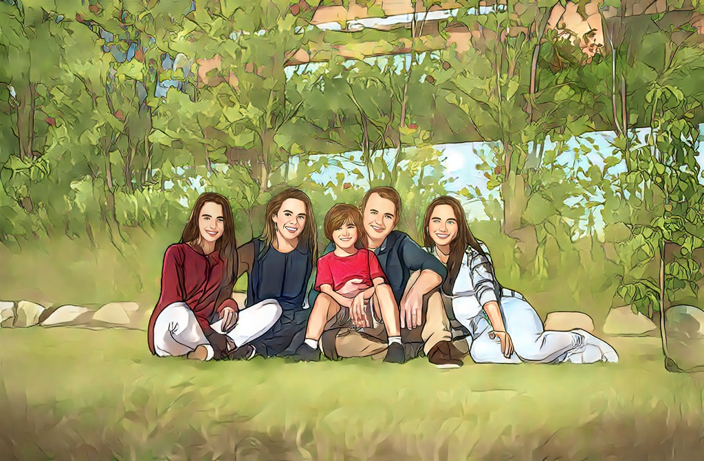
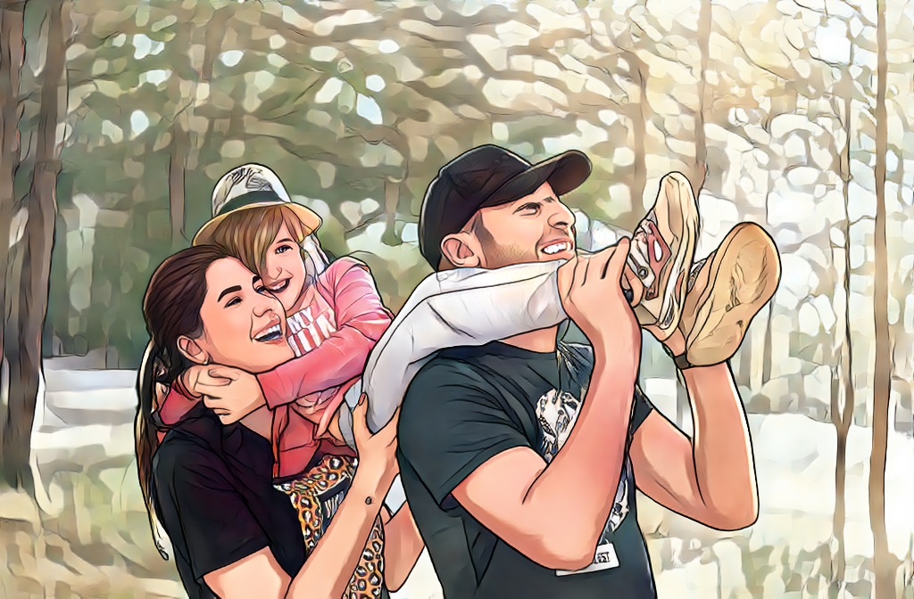
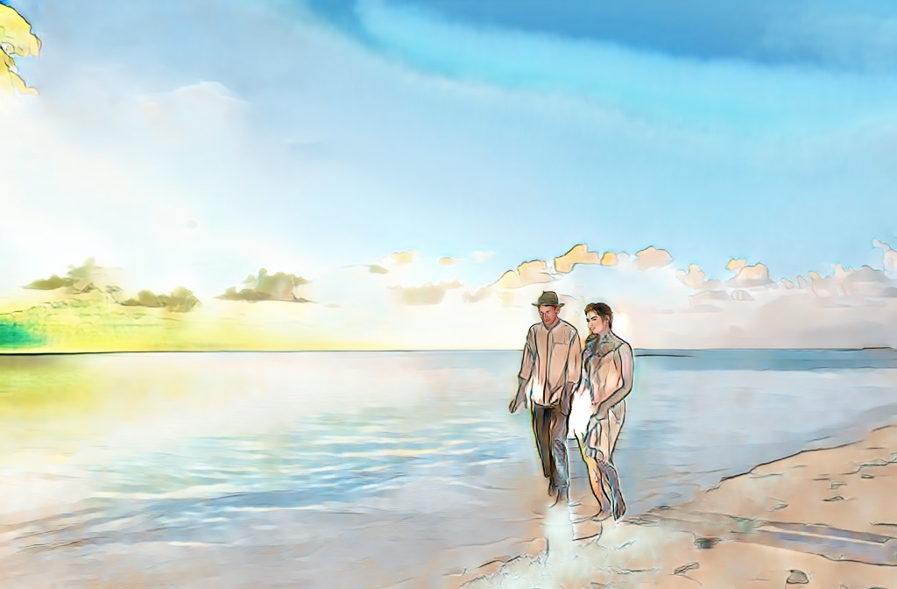
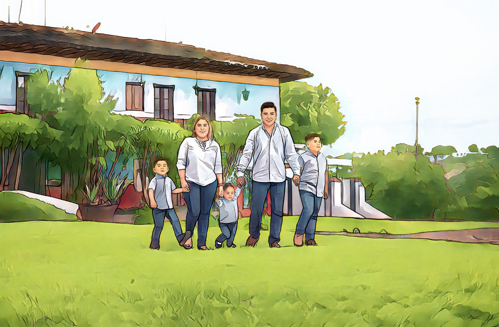

<p align="center">
  <h1 align="center">Cartoonify - Turn Photos into Illustrations</h1>
  <p align="center">
    A lightweight pix2pix-HD model that transforms real photos into beautiful cartoon/illustration-style artwork. Built with a custom U-Net architecture, featuring a dedicated face refinement pipeline for stunning facial details.
  </p>
</p>

<p align="center">
  <a href="https://www.thearifoffice.com">Website</a> &nbsp;&bull;&nbsp;
  <a href="#getting-started">Getting Started</a> &nbsp;&bull;&nbsp;
  <a href="#usage">Usage</a>
</p>

---

## Results

<p align="center">
  
  &nbsp;&nbsp;
  
</p>

<p align="center">
  
  &nbsp;&nbsp;
  
</p>

<p align="center">
  
  &nbsp;&nbsp;
  
</p>

## Highlights

- **Single-pass inference** - no diffusion steps, no iterative denoising. One forward pass and done.
- **Face refinement pipeline** - a dedicated face refiner model redraws small faces with crisp detail, blended seamlessly back into the scene.
- **Runs on CPU** - no GPU required. ~5s per photo on a desktop CPU, under 1s on GPU.
- **Lightweight** - just two files of inference code. No heavy frameworks, no cloud dependency.
- **Batch processing** - point it at a folder and cartoonify everything in one go.

## Architecture

The model uses a **U-Net generator** with skip connections at multiple resolutions. The main model processes the full image at 1024px, while the face refiner operates on detected face crops at 256px. Face detections are blended back using a feathered elliptical mask with colour-matched boundaries for seamless compositing.

```
Photo --> [Main U-Net (1024px)] --> Illustration
                                        |
Photo --> [Face Detector] --> crops --> [Face Refiner U-Net (256px)] --> blend back
```

## Getting Started

### 1. Clone this repo

```bash
git clone https://github.com/ArifOffice/cartoonify-pix2pixhd.git
cd cartoonify-pix2pixhd
```

### 2. Download weights

Download the model weights and place them in a `weights/` folder:

| File | Size | Description |
|---|---|---|
| `main_v7.pth` | 78 MB | Main illustration model |
| `face_refiner_v7.pth` | 78 MB | Face refinement model |
| `face_detection_yunet_2023mar.onnx` | 0.2 MB | YuNet face detector |

> Weights are not included in this repo due to size. Visit [www.thearifoffice.com](https://www.thearifoffice.com) for download links and more details.

### 3. Install dependencies

```bash
python -m venv venv
source venv/bin/activate        # Windows: venv\Scripts\activate
pip install -r requirements.txt
```

For CPU-only (smaller install):

```bash
pip install torch --index-url https://download.pytorch.org/whl/cpu
pip install opencv-python numpy pillow
```

## Usage

### Command line

```bash
# Single image
python cartoonify.py --input photo.jpg

# Entire folder
python cartoonify.py --input my_photos --out my_results

# Side-by-side comparison output
python cartoonify.py --input photo.jpg --compare

# Force CPU
python cartoonify.py --input photo.jpg --device cpu
```

### Options

| Option | Default | Description |
|---|---|---|
| `--input` | *(required)* | One image or a folder of images (jpg, png, webp) |
| `--out` | `results` | Output folder |
| `--device` | auto | `cuda` or `cpu` |
| `--threads` | 4 | CPU threads (when running on CPU) |
| `--long_side` | 1024 | Longer side of the output in pixels |
| `--max_face` | 320 | Redraw faces up to this height (px) |
| `--no_face_refiner` | off | Skip face refinement (faster) |
| `--compare` | off | Save photo + result side by side |

### Python API

**Simplest (one-liner):**

```python
from cartoonify import cartoonify

cartoonify("photo.jpg").save("cartoon.jpg")
```

**For batch processing (load once, run many):**

```python
from cartoonify import Cartoonifier

c = Cartoonifier(device="cpu")          # load models once
c("photo1.jpg").save("out1.jpg")        # accepts file paths
c("photo2.jpg").save("out2.jpg")        # or PIL Images
```

## What works best

- Daylight photos of people: portraits, couples, families, groups, full body
- Landscapes, street scenes, pets

## Project structure

```
cartoonify.py        # Inference script (CLI + importable)
model.py             # U-Net generator architecture
requirements.txt     # Python dependencies
samples/             # Sample output showcase
weights/             # Model weights (not included, see above)
```

---

<p align="center">

**If you find this useful, please give it a star and follow!**

Built by [TheArifOffice Engineering](https://www.thearifoffice.com)

For much more depth on this model, the training process, and our other projects, visit **[www.thearifoffice.com](https://www.thearifoffice.com)**

</p>
